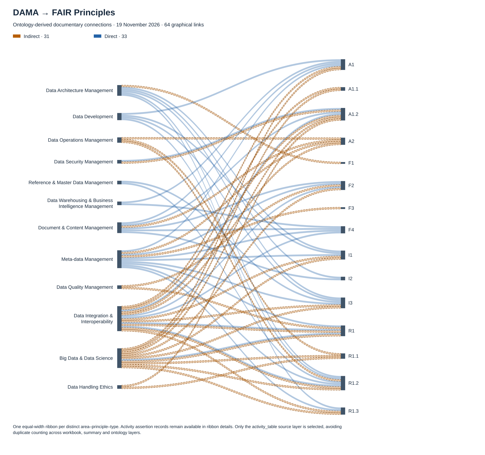

# DAMA → FAIR Principles

**Question:** Which DAMA areas and topics have source activity assertions supporting each FAIR principle, and with which Direct/Indirect type?

One equal-width ribbon per distinct area–principle–type. Activity assertion records remain available in ribbon details. Only the activity_table source layer is selected, avoiding duplicate counting across workbook, summary and ontology layers.



<button id="load" type="button">Load interactive diagram</button><iframe id="frame" title="DAMA → FAIR Principles Sankey" width="100%" height="1200" style="display:none;border:0"></iframe><script>document.getElementById('load').onclick=()=>{const f=document.getElementById('frame');f.src='high-level-dama-fair-principles-sankey.html?v=7d1a1314ddfa';f.style.display='block';document.getElementById('load').hidden=true};window.addEventListener('message',e=>{const f=document.getElementById('frame');if(e.source===f.contentWindow&&e.data?.type==='high-level-height'&&Number.isFinite(e.data.height))f.height=String(Math.min(30000,e.data.height+20))})</script>

[Interactive diagram](high-level-dama-fair-principles-sankey.html?v=7d1a1314ddfa) · [Offline interaction](high-level-dama-fair-principles-sankey-offline.html) · [SVG](high-level-dama-fair-principles-sankey.svg) · [PNG](high-level-dama-fair-principles-sankey.png) · [Query](query.rq) · [Extracted rows](extracted-rows.json) · [Graph data](high-level-dama-fair-principles-sankey.json)

## SPARQL

```sparql
PREFIX align: <urn:fair-dama-fairmm:alignment:>
PREFIX dcterms: <http://purl.org/dc/terms/>
PREFIX rdfs: <http://www.w3.org/2000/01/rdf-schema#>
SELECT DISTINCT ?assertion ?area ?areaLabel ?practice ?practiceLabel ?principle ?kind ?source
WHERE {
  ?assertion a align:SourceAssertion ; align:sourceLayer "activity_table" ;
    align:inSourceTopic ?area ; align:hasPractice ?practice ;
    align:targetsPrinciple ?principle ; align:existingContributionType ?kind .
  ?area rdfs:label ?areaLabel . ?practice rdfs:label ?practiceLabel .
  OPTIONAL { ?assertion align:primarySource ?source }
}
ORDER BY ?area ?principle ?kind ?assertion
```

The query is executed against the nine-module local RDF union. No automatic OWL imports or inference are used. All source triples remain unchanged.
