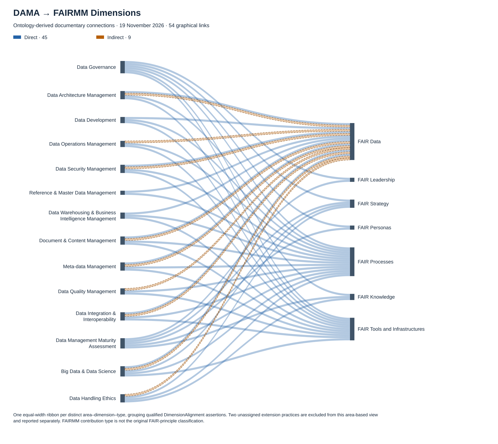

# DAMA → FAIRMM Dimensions

**Question:** Which DAMA areas and topics support each FAIRMM dimension through qualified Direct or Indirect assertions?

One equal-width ribbon per distinct area–dimension–type, grouping qualified DimensionAlignment assertions. Two unassigned extension practices are excluded from this area-based view and reported separately. FAIRMM contribution type is not the original FAIR-principle classification.



<button id="load" type="button">Load interactive diagram</button><iframe id="frame" title="DAMA → FAIRMM Dimensions Sankey" width="100%" height="1200" style="display:none;border:0"></iframe><script>document.getElementById('load').onclick=()=>{const f=document.getElementById('frame');f.src='high-level-dama-fairmm-dimensions-sankey.html?v=9f6e62169cf5';f.style.display='block';document.getElementById('load').hidden=true};window.addEventListener('message',e=>{const f=document.getElementById('frame');if(e.source===f.contentWindow&&e.data?.type==='high-level-height'&&Number.isFinite(e.data.height))f.height=String(Math.min(30000,e.data.height+20))})</script>

[Interactive diagram](high-level-dama-fairmm-dimensions-sankey.html?v=9f6e62169cf5) · [Offline interaction](high-level-dama-fairmm-dimensions-sankey-offline.html) · [SVG](high-level-dama-fairmm-dimensions-sankey.svg) · [PNG](high-level-dama-fairmm-dimensions-sankey.png) · [Query](query.rq) · [Extracted rows](extracted-rows.json) · [Graph data](high-level-dama-fairmm-dimensions-sankey.json)

## SPARQL

```sparql
PREFIX align: <urn:fair-dama-fairmm:alignment:>
PREFIX dcterms: <http://purl.org/dc/terms/>
PREFIX rdfs: <http://www.w3.org/2000/01/rdf-schema#>
SELECT DISTINCT ?assertion ?area ?areaLabel ?practice ?practiceLabel ?dimension ?dimensionLabel ?kind ?rationale ?condition
WHERE {
  ?assertion a align:DimensionAlignment ; align:sourceTopic ?area ;
    align:fromPractice ?practice ; align:targetsDimension ?dimension ;
    align:contributionType ?kind .
  ?area rdfs:label ?areaLabel . ?practice rdfs:label ?practiceLabel .
  ?dimension rdfs:label ?dimensionLabel .
  OPTIONAL { ?assertion align:rationale ?rationale }
  OPTIONAL { ?assertion align:applicabilityCondition ?condition }
}
ORDER BY ?area ?dimension ?kind ?assertion
```

The query is executed against the nine-module local RDF union. No automatic OWL imports or inference are used. All source triples remain unchanged.
