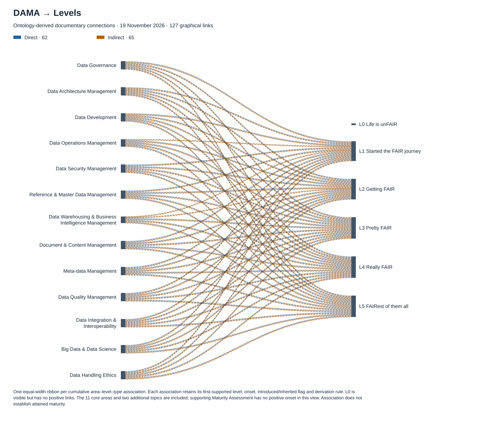

# DAMA → Levels

**Question:** At which levels are DAMA area/type associations introduced or inherited, and which onset judgement and derivation rule explain them?

One equal-width ribbon per cumulative area–level–type association. Each association retains its first-supported level, onset, introduced/inherited flag and derivation rule. L0 is visible but has no positive links. The 11 core areas and two additional topics are included; supporting Maturity Assessment has no positive onset in this view. Association does not establish attained maturity.



<button id="load" type="button">Load interactive diagram</button><iframe id="frame" title="DAMA → Levels Sankey" width="100%" height="1200" style="display:none;border:0"></iframe><script>document.getElementById('load').onclick=()=>{const f=document.getElementById('frame');f.src='high-level-dama-levels-sankey.html?v=ff0894c025e8';f.style.display='block';document.getElementById('load').hidden=true};window.addEventListener('message',e=>{const f=document.getElementById('frame');if(e.source===f.contentWindow&&e.data?.type==='high-level-height'&&Number.isFinite(e.data.height))f.height=String(Math.min(30000,e.data.height+20))})</script>

[Interactive diagram](high-level-dama-levels-sankey.html?v=ff0894c025e8) · [Offline interaction](high-level-dama-levels-sankey-offline.html) · [SVG](high-level-dama-levels-sankey.svg) · [PNG](high-level-dama-levels-sankey.png) · [Query](query.rq) · [Extracted rows](extracted-rows.json) · [Graph data](high-level-dama-levels-sankey.json)

## SPARQL

```sparql
PREFIX align: <urn:fair-dama-fairmm:alignment:>
PREFIX dcterms: <http://purl.org/dc/terms/>
PREFIX rdfs: <http://www.w3.org/2000/01/rdf-schema#>
SELECT DISTINCT ?association ?area ?areaLabel ?level ?levelLabel ?ordinal ?kind ?onset ?firstLevel ?inherited ?rule
WHERE {
  ?association a align:CumulativeAssociation ; align:sourceTopic ?area ;
    align:targetsLevel ?level ; align:contributionType ?kind ;
    align:derivedFromOnset ?onset ; align:firstSupportedLevel ?firstLevel ;
    align:inherited ?inherited ; align:derivationRule ?rule .
  ?area rdfs:label ?areaLabel .
  ?level rdfs:label ?levelLabel ; align:levelOrdinal ?ordinal .
}
ORDER BY ?area ?ordinal ?kind
```

The query is executed against the nine-module local RDF union. No automatic OWL imports or inference are used. All source triples remain unchanged.
