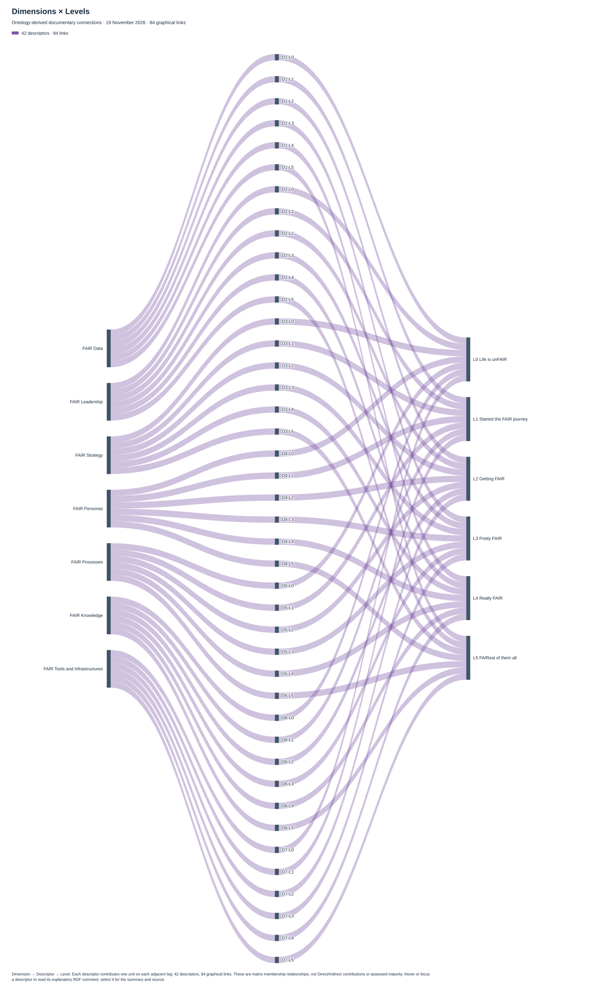

# Dimensions × Levels

**Question:** How do the seven dimensions and six ordered levels connect through the 42 contextual descriptors?

Dimension → Descriptor → Level. Each descriptor contributes one unit on each adjacent leg: 42 descriptors, 84 graphical links. These are matrix membership relationships, not Direct/Indirect contributions or assessed maturity. Hover or focus a descriptor to read its explanatory RDF comment; select it for the summary and source.



<button id="load" type="button">Load interactive diagram</button><iframe id="frame" title="Dimensions × Levels Sankey" width="100%" height="1200" style="display:none;border:0"></iframe><script>document.getElementById('load').onclick=()=>{const f=document.getElementById('frame');f.src='high-level-dimensions-levels-sankey.html?v=3d681f49ad01';f.style.display='block';document.getElementById('load').hidden=true};window.addEventListener('message',e=>{const f=document.getElementById('frame');if(e.source===f.contentWindow&&e.data?.type==='high-level-height'&&Number.isFinite(e.data.height))f.height=String(Math.min(30000,e.data.height+20))})</script>

[Interactive diagram](high-level-dimensions-levels-sankey.html?v=3d681f49ad01) · [Offline interaction](high-level-dimensions-levels-sankey-offline.html) · [SVG](high-level-dimensions-levels-sankey.svg) · [PNG](high-level-dimensions-levels-sankey.png) · [Query](query.rq) · [Extracted rows](extracted-rows.json) · [Graph data](high-level-dimensions-levels-sankey.json)

## SPARQL

```sparql
PREFIX align: <urn:fair-dama-fairmm:alignment:>
PREFIX dcterms: <http://purl.org/dc/terms/>
PREFIX rdfs: <http://www.w3.org/2000/01/rdf-schema#>
SELECT DISTINCT ?dimension ?dimensionLabel ?descriptor ?descriptorID ?descriptorComment ?level ?levelLabel ?ordinal ?source
WHERE {
  ?descriptor a align:Descriptor ; align:inDimension ?dimension ;
    align:atLevel ?level ; dcterms:identifier ?descriptorID .
  ?dimension a align:Dimension ; rdfs:label ?dimensionLabel .
  ?level a align:MaturityLevel ; rdfs:label ?levelLabel ; align:levelOrdinal ?ordinal .
  OPTIONAL { ?descriptor rdfs:comment ?descriptorComment }
  OPTIONAL { ?descriptor align:primarySource ?source }
}
ORDER BY ?dimension ?ordinal
```

The query is executed against the nine-module local RDF union. No automatic OWL imports or inference are used. All source triples remain unchanged.
