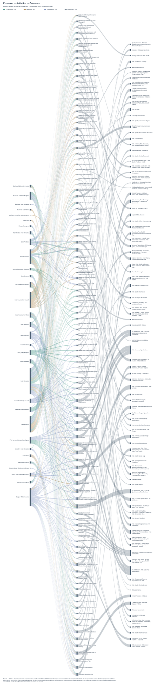

# Personas → Activities → Outcomes

**Question:** Which DAMA personas occur in recorded activity responsibilities, and which intended deliverables are connected to those practices?

Persona → Activity → Intended deliverable. Persona-to-activity weight counts distinct RDF ActivityRoleOccurrence resources, retaining role categories in the details. An activity’s incoming count is allocated equally across its distinct deliverables to conserve flow. Width measures documentary role occurrences, not effort, accountability or verified outcomes. Only occurrences already materialised in the ontology are included; this is not a complete extraction of every workbook role. Area-level supplier/participant/consumer occurrences are not used.



<button id="load" type="button">Load interactive diagram</button><iframe id="frame" title="Personas → Activities → Outcomes Sankey" width="100%" height="1200" style="display:none;border:0"></iframe><script>document.getElementById('load').onclick=()=>{const f=document.getElementById('frame');f.src='high-level-personas-activities-outcomes-sankey.html?v=5eb9577ecf76';f.style.display='block';document.getElementById('load').hidden=true};window.addEventListener('message',e=>{const f=document.getElementById('frame');if(e.source===f.contentWindow&&e.data?.type==='high-level-height'&&Number.isFinite(e.data.height))f.height=String(Math.min(30000,e.data.height+20))})</script>

[Interactive diagram](high-level-personas-activities-outcomes-sankey.html?v=5eb9577ecf76) · [Offline interaction](high-level-personas-activities-outcomes-sankey-offline.html) · [SVG](high-level-personas-activities-outcomes-sankey.svg) · [PNG](high-level-personas-activities-outcomes-sankey.png) · [Query](query.rq) · [Extracted rows](extracted-rows.json) · [Graph data](high-level-personas-activities-outcomes-sankey.json)

## SPARQL

```sparql
PREFIX align: <urn:fair-dama-fairmm:alignment:>
PREFIX dcterms: <http://purl.org/dc/terms/>
PREFIX rdfs: <http://www.w3.org/2000/01/rdf-schema#>
SELECT DISTINCT ?occurrence ?persona ?personaLabel ?role ?practice ?practiceLabel ?deliverable ?deliverableLabel ?source
WHERE {
  ?occurrence a align:ActivityRoleOccurrence ; align:sourcePersona ?persona ;
    align:sourceRoleCategory ?role ; align:concernsPractice ?practice .
  ?persona rdfs:label ?personaLabel . ?practice rdfs:label ?practiceLabel ;
    align:hasDeliverable ?deliverable .
  ?deliverable rdfs:label ?deliverableLabel .
  OPTIONAL { ?occurrence dcterms:source ?source }
}
ORDER BY ?persona ?practice ?role ?deliverable ?occurrence
```

The query is executed against the nine-module local RDF union. No automatic OWL imports or inference are used. All source triples remain unchanged.
