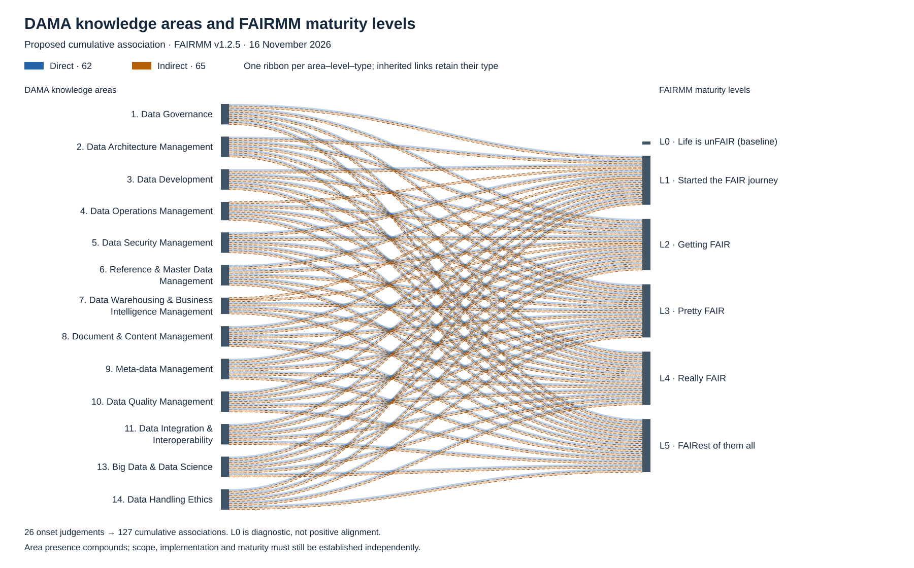

# DAMA knowledge areas and FAIRMM maturity levels

The earliest supported level is proposed from the full L0–L5 descriptors. Every association is carried forward through L5, preserving its Direct or Indirect type. L0 is a diagnostic baseline with no positive ribbons. There are 127 cumulative ribbons derived from 26 onset judgements, not 127 independent capabilities.

<button id="load-levels" type="button">Load interactive diagram</button>
<iframe id="levels-frame" title="Interactive cumulative FAIRMM level alignment" width="100%" height="1350" loading="lazy" style="border:0;display:none;"></iframe>

[Open interactive diagram](dama-fairmm-levels-sankey.html?v=40a7227a5e52) · [Offline fallback](dama-fairmm-levels-sankey-offline.html) · [SVG](dama-fairmm-levels-sankey.svg) · [Data](dama-fairmm-levels-sankey.json)

[Read the onset analysis and source evidence](analysis.md). Hover nodes, select ribbons for rationale and deliverables, and select labels to open documentation. No dropdown selectors are required.

The 11 core areas retain the source terminology, including Data Development and Data Operations. Big Data & Data Science and Data Handling Ethics are included as additional topics. The aggregate overview and supporting Maturity Assessment discipline are excluded. Higher levels increase scope and capability requirements; the diagram does not assign organisational maturity or require every early process to remain unchanged.
