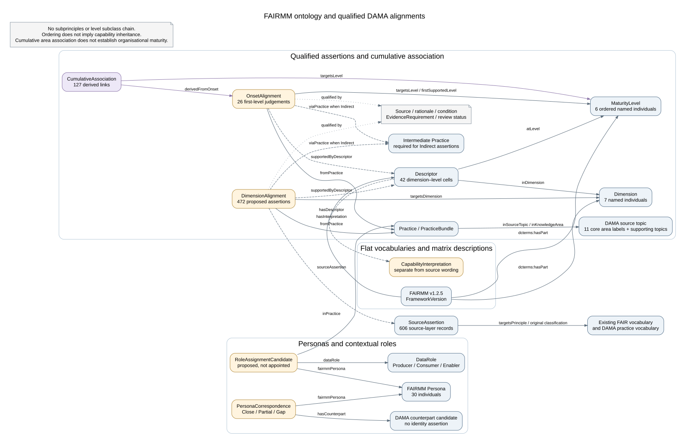

# FAIRMM ontology

The FAIRMM ontology follows the existing FAIR–DAMA patterns: named individuals in flat vocabularies, explicit framework membership and qualified contribution assertions. Dimension and maturity-level vocabularies have no subprinciples. Levels are ordered individuals, not subclasses of each other.



For the accepted integrated asserted distribution and source/provenance dataset, see [Integrated ontology](integrated/index.md). The module tables and existing diagrams below describe the documentary model.

## Download the modules

| Module | Triples | Contents |
| --- | --- | --- |
| [fairmm-core.ttl](ontology-data/fairmm-core.ttl) | 339 | OWL/RDFS classes, typed properties, cardinality restrictions and contribution semantics. |
| [fairmm-v1.2.5.ttl](ontology-data/fairmm-v1.2.5.ttl) | 1080 | Framework version, seven dimensions, six ordered levels and 42 source descriptors. |
| [fairmm-personas.ttl](ontology-data/fairmm-personas.ttl) | 4510 | Thirty FAIRMM personas, three data roles and qualified counterpart comparisons. |
| [fairmm-dama-alignment.ttl](ontology-data/fairmm-dama-alignment.ttl) | 68525 | Source practices, source-layer assertions, dimension alignments, level onsets and contextual role candidates. |
| [fairmm-dama-derived.ttl](ontology-data/fairmm-dama-derived.ttl) | 4128 | Cumulative level associations derived from RDF onset assertions and level ordinals. |

Load all five files together. Module imports use local URN identifiers and are resolved by the supplied loader; it never fetches remote imports.

## Vocabulary structure

`Dimension` and `MaturityLevel` are classes. Their seven and six named individuals belong to `FAIRMM-v1.2.5` through `dcterms:hasPart`. Version-specific enumeration classes and `owl:AllDifferent` follow the existing FAIR/DAMA vocabulary pattern. The 42 descriptors are separate individuals, each with one `inDimension` and one `atLevel` relation. Framework membership does not make descriptors subdivisions or subprinciples.

Each vocabulary member has an identifier, label, definition, version context and pinned source. Levels have ordinal values 0–5, five immediate `nextLevel` links and the explicit `precedes` ordering. Ordering alone does not imply capability inheritance or organisational maturity.

The term namespace remains `urn:fair-dama-fairmm:alignment:`. Existing D1–D7 and descriptor identifiers are reused. New classes, levels and supporting resources stay in that independent namespace; no new resource is represented as published in FAIR–DAMA.

## Qualified alignments and pattern reuse

`DimensionAlignment` targets exactly one dimension. `OnsetAlignment` targets exactly one first-supported level. Each assertion retains its practice, source knowledge-area/topic context, contribution type, rationale, applicability condition, evidence requirement and review status. The two extensions without an assigned source area remain explicitly unassigned; no area is invented.

Direct support produces or verifies evidence addressing the target capability. Indirect support names an intermediate practice using `viaPractice`. A separate `sourceIntermediatePractice` relation preserves enabling paths attached to original FAIR-principle assertions. Source FAIR classification is not substituted for dimension or level contribution type.

The original FAIR-targeted properties are not repurposed: their domains and ranges would otherwise classify FAIRMM alignments as FAIR contribution assertions. The new properties reuse the pattern without changing upstream meanings.

Catalogue overview, detailed section summary, Markdown activity, workbook activity, ontology contribution and ontology area-assessment assertions remain distinct named resources. Historical visualisation assertions remain in the archived corpus. Original source fields are linked resources, with headings, positions and exact text. Descriptor support, role occurrences, deliverables and counterpart candidates are also linked resources, not JSON blobs in RDF literals.

All 42 descriptors have an English `rdfs:comment` explaining the corresponding FAIRMM dimension–level cell in plain language. These comments are project-authored paraphrases, not verbatim upstream definitions, additional assessment requirements or maturity results. Their source context is the descriptor’s pinned `primarySource`; the exact original wording remains in `fullSourceBlock`. The [descriptor comments query](ontology-data/queries/descriptor-comments.rq) retrieves both separately. The high-level interactive and offline Sankeys show the comment on descriptor hover, keyboard focus and selection. Exact descriptor text is stored in `fullSourceBlock`. Source-cited clauses use `DescriptorEvidence`. Proposed interpretations are separate `CapabilityInterpretation` resources; they are not treated as new authoritative FAIRMM wording.

## Personas and role context

Thirty FAIRMM persona individuals and Producer, Consumer and Enabler data roles are represented. Persona correspondences retain Close, Partial or Gap status. Gap counterpart records are explicitly related counterparts, without equivalence or identity assertions.

Area-level Supplier/Participant/Consumer occurrences remain distinct from Responsible/Approving/Contributing activity-role occurrences. Data-role assignment candidates identify a persona, a specific practice, a role and their source occurrence. They are proposals, not appointments or declarations of legal authority. General role suggestions remain attached to correspondence records with an explicit requirement for activity context.

The source knowledge-area labels retain their original edition context. Existing recorded correspondences to the canonical DAMA vocabulary are preserved, but differing labels are not merged with `owl:sameAs` or an equivalent-class assertion.

## Cumulative association

The 26 onset judgements are original proposed alignments. The separate derived module contains 127 projections: 26 introduced associations at their onset levels and 101 inherited associations at higher levels. These projections are not 127 independent capability judgements and must not be added to the onset count as independent evidence.

Every derived association names its onset, derivation rule, first supported level, target level and introduced/inherited status. The practice, area and Direct/Indirect type are retained. The rule is implemented both as an RDF-driven materializer and as an independently checked [SPARQL CONSTRUCT](ontology-data/queries/cumulative-construct.rq).

L0 descriptors and diagnostic reviews are retained, but no positive L0 alignment is asserted. Cumulative area association does not require every early process to remain unchanged. No organisation is declared to have attained any maturity level.

## Validation and regression

The current build passes **970 ontology checks**, including negative cases for duplicate descriptor levels, missing Indirect pathways, changed inherited type and positive L0 claims. Validation uses RDFLib, ordinary scripts and SPARQL. No SHACL files or dependencies are used.

| Resource | Count |
| --- | --- |
| Dimension | 7 |
| MaturityLevel | 6 |
| Descriptor | 42 |
| Persona | 30 |
| DataRole | 3 |
| DimensionAlignment | 472 |
| OnsetAlignment | 26 |
| CumulativeAssociation | 127 |
| RoleAssignmentCandidate | 1445 |
| AreaRoleOccurrence | 278 |
| ActivityRoleOccurrence | 356 |
| SourceAssertion | 606 |

Both Sankeys are regenerated from RDF-extracted records using the existing renderers. Their static/on-demand D3 presentation and selector-free interaction are preserved. Source-release proposed JSON is used only for regression comparison. The 54 dimension relationships and 127 level relationships match exactly; intermediate activity record counts and first-level/inherited flags also agree.

Validation checks exact descriptor source blocks, persona definitions, all original activity-table fields, source-layer classification, target types, required fields, cumulative closure and unchanged source checkouts. OWL axioms document the model; the scripts provide the closed checks that OWL's open-world semantics do not perform by themselves. This is structural and documentary validation, not an operational pilot or full formal OWL consistency proof.

## Query examples

Run a query from the project root:

```powershell
.venv/Scripts/python.exe scripts/query_fairmm_ontology.py scripts/queries/earliest-levels.rq
.venv/Scripts/python.exe scripts/query_fairmm_ontology.py scripts/queries/indirect-pathways.rq
.venv/Scripts/python.exe scripts/query_fairmm_ontology.py scripts/queries/contextual-roles.rq
```

Available downloads: [dimension links](ontology-data/queries/dimension-links.rq), [level links](ontology-data/queries/level-links.rq), [earliest levels](ontology-data/queries/earliest-levels.rq), [Indirect pathways](ontology-data/queries/indirect-pathways.rq), [persona comparisons](ontology-data/queries/persona-correspondences.rq), [contextual roles](ontology-data/queries/contextual-roles.rq), and [source layers](ontology-data/queries/source-layers.rq).

## Reproduce the build

```powershell
pwsh -File scripts/build_ontology_all.ps1
```

The pipeline creates the modules, validates them, extracts RDF diagram inputs, regenerates the SVG/HTML/PNG outputs, renders this ontology diagram and builds the documentation. The sibling FAIR–DAMA and FAIR-Maturity-Matrix repositories remain read-only. Nothing is pushed or deployed.

## Sources and attribution

FAIRMM source material is attributed to the Pistoia Alliance FAIR Maturity Matrix contributors, branch `FAIR-MM-V1.2.5`, revision `8ff4676eb340b0da5034ffb3d0e901c594c3cfc4`. The repository carries GPL-3.0; the persona overview separately states CC BY 4.0. The [upstream repository licence](ontology-data/FAIRMM-LICENSE.txt) is retained. These notices are not replaced by a blanket licence for all components.

DAMA mappings and definitions are attributed to Chris Day, supplied ontology v1.1.0 / document v1.18.0 / workbook V3 release, 16 November 2026. The checkout revision is context only. Preserve source-component notices and DAMA International source-image copyright. See the [source refresh](source-refresh.md) for provenance and combined load order. The original FAIR vocabulary retains its own identifiers, authorship and CC BY 4.0 notice. Pinned references and source digests are recorded in the build manifest.


## Source ontology dependencies

Use the supplied v1.1.0 source modules for this release: [FAIR](ontology-data/dama-source-v1.1.0/fair-ontology.ttl), [DAMA](ontology-data/dama-source-v1.1.0/dama-ontology.ttl), [FAIR mappings](ontology-data/dama-source-v1.1.0/dama-fair-mapping.ttl), [DAMA personas](ontology-data/dama-source-v1.1.0/dama-persona-ontology.ttl). These are byte-identical copies from the supplied package; the sibling repository is unchanged.
