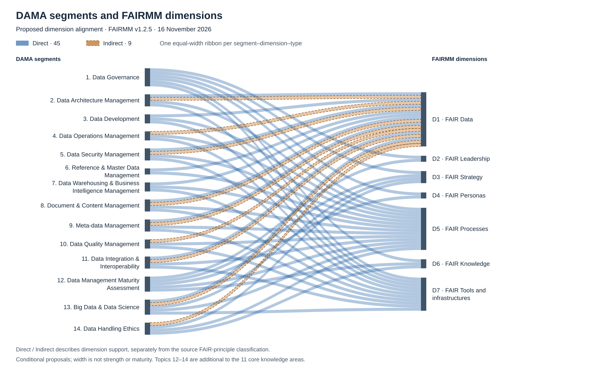

# DAMA segments and FAIRMM dimensions

The interactive diagram follows the FAIR–DAMA approach: hover or focus on a segment or dimension to highlight its connections, select a ribbon for rationale and deliverables, and select a label to open its documentation. DAMA labels open the corresponding FAIR–DAMA segment page; dimension labels open the pinned FAIRMM dimension page.

It uses the same pinned D3 and D3 Sankey libraries as FAIR–DAMA, loaded from jsDelivr only when you choose **Load interactive diagram** or open it directly.

<button id="load-fairmm-sankey" type="button">Load interactive diagram</button>

<iframe id="fairmm-sankey-frame" title="Interactive DAMA segments and FAIRMM dimensions Sankey" width="100%" height="1350" loading="lazy" style="border:0;display:none;"></iframe>

[Open the interactive diagram on its own](dama-fairmm-dimensions-sankey.html?v=cf3cdfe613b6) · [Offline interactive fallback](dama-fairmm-dimensions-sankey-offline.html) · [SVG download](dama-fairmm-dimensions-sankey.svg) · [Source data](dama-fairmm-dimensions-sankey.json)

The diagram shows **45 Direct** and **9 Indirect** proposed relationships between 14 DAMA areas and additional topics and seven FAIRMM dimensions. One equal-width ribbon represents one distinct segment–dimension–type combination, grouping repeated activity records. Width does not indicate strength or maturity.

Direct and Indirect refer to **dimension support**, which is separate from the existing FAIR-principle classification. All current Indirect dimension relationships target FAIR Data in the current crosswalk. Other dimension relationships can be Direct even when their source principle contribution is Indirect, because they address a workflow or infrastructure descriptor directly.

The aggregate Data Management overview and two extensions without a segment assignment are excluded. Maturity Assessment is included as supporting segment 12. The 54 ribbons group 470 activity/descriptor records; they remain conditional documentary proposals. Select a ribbon in the interactive version to inspect the original source classification, activities, conditions and versioned sources.
