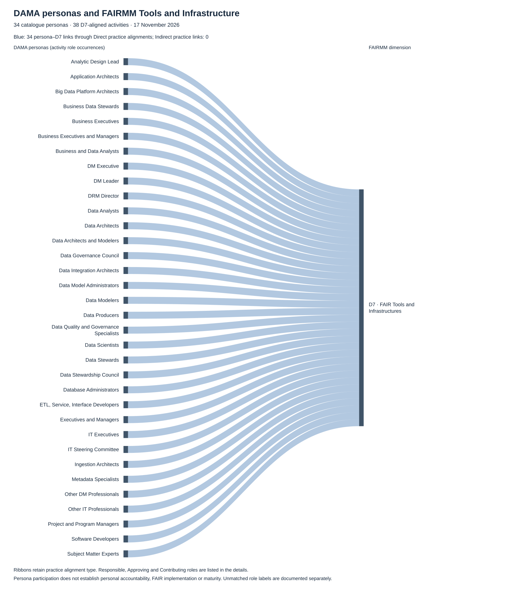

# DAMA personas and FAIRMM Tools and Infrastructure

34 DAMA catalogue personas connect through 38 activities with 86 proposed D7 alignment records. All current D7 practice alignments are Direct; none are Indirect. This is a projection through source activity roles, not a Direct classification of the personas themselves.

<button id="load" type="button">Load interactive diagram</button><iframe id="frame" title="Tools and Infrastructure persona Sankey" width="100%" height="2478" style="display:none;border:0"></iframe>

[Open interactive diagram](dama-fairmm-tools-personas-sankey.html?v=cd7906dd2929) · [Offline fallback](dama-fairmm-tools-personas-sankey-offline.html) · [Evidence JSON](dama-fairmm-tools-personas-sankey.json)

The diagram uses exact catalogue-name matches in Responsible, Approving and Contributing fields. Comma-containing catalogue names are matched before splitting labels. No acronym expansion, fuzzy equivalence, area-level responsibility inference or automatic supplier/consumer role conversion is applied. One equal-width ribbon groups each persona and D7 practice-alignment type; repeated FAIR IDs do not increase width. Select a ribbon for activities, original role text, deliverables, conditions and descriptor references.

## Unmatched source role fragments

These remain unassigned rather than being silently merged into catalogue personas. The JSON retains the full source fields and coordinates.

| Activity | Role | Unmatched text |
|---|---|---|
| ACT-01-007 | Approving | CDO |
| ACT-01-007 | Contributing | Enterprise Data Architect; Data Stewardship Committee |
| ACT-02-002 | Responsible | Enterprise Data Architect |
| ACT-02-002 | Approving | Data Architecture Steering Committee; CDO |
| ACT-02-002 | Contributing | Data Stewards / Teams |
| ACT-02-005 | Responsible | Enterprise Data Architect |
| ACT-02-005 | Approving | CDO; Data Architecture Steering Committee |
| ACT-02-005 | Contributing | Data Integration Specialists; Other Data Management Professionals |
| ACT-02-008 | Responsible | Metadata Architect |
| ACT-02-008 | Approving | Enterprise Data Architect; CDO; Data Architecture Steering Committee |
| ACT-02-008 | Contributing | Other Data Management. Professionals |
| ACT-03-005 | Responsible | DBAs |
| ACT-03-005 | Approving | DBAs |
| ACT-03-007 | Responsible | DBAs |
| ACT-03-007 | Contributing | DBAs |
| ACT-03-008 | Responsible | Data Integration Specialists; DBAs |
| ACT-03-008 | Approving | DBAs |
| ACT-03-008 | Contributing | DBAs |
| ACT-03-011 | Contributing | DBAs |
| ACT-03-016 | Contributing | DBAs |
| ACT-04-004 | Responsible | DBAs |
| ACT-05-008 | Responsible | Document Authors; Report Designers |
| ACT-05-008 | Approving | Management |
| ACT-07-004 | Responsible | Business Intelligence Specialists |
| ACT-07-004 | Approving | Data Warehouse Architect; Data Stewardship Committee |
| ACT-07-004 | Contributing | Data Warehouse Architect; Other Data Mgmt. Professionals |
| ACT-08-002 | Responsible | Document System Managers; Records Managers |
| ACT-08-006 | Responsible | Knowledge Managers |
| ACT-08-007 | Responsible | Document Systems Managers; Records Managers |
| ACT-09-001 | Approving | Enterprise Data Architect; Data Stewardship Committee; Data Stewardship Committee; Data Stewardship Committee; Data Stewardship Committee; Data Stewardship Committee |
| ACT-09-002 | Responsible | Metadata Architects |
| ACT-09-002 | Approving | Enterprise Data Architect; CDO; Data Stewardship Committee Database Administrators |
| ACT-09-002 | Contributing | Other Data Mgmt. Professionals |
| ACT-09-003 | Responsible | Metadata and Data Architects |
| ACT-09-003 | Approving | Enterprise Data Architect; Data Stewardship Committee |
| ACT-09-004 | Approving | Enterprise Data Architect; Data Stewardship Committee |
| ACT-09-005 | Approving | Enterprise Data Architect; Data Stewardship Committee |
| ACT-09-006 | Responsible | Integration Data Architects |
| ACT-09-006 | Approving | Enterprise Data Architect; Data Stewardship Committee |
| ACT-09-007 | Approving | Enterprise Data Architect; Data Stewardship Committee |
| ACT-09-008 | Approving | Enterprise Data Architect; Data Stewardship Committee |
| ACT-09-008 | Contributing | Metadata Architects |
| ACT-09-009 | Responsible | Metadata Analysts |
| ACT-09-009 | Approving | Enterprise Data Architect; Data Stewardship Committee |
| ACT-09-009 | Contributing | Business Intelligence Specialists; Data Integration Specialists; Other Data Mgmt. Professionals; Data Integration Specialists; Other Data Mgmt. Professionals |
| ACT-10-007 | Responsible | Data Quality Manager |
| ACT-10-007 | Approving | Business Managers |
