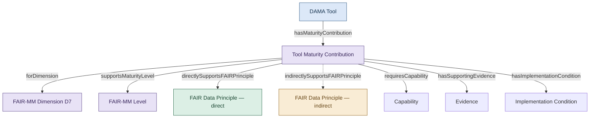
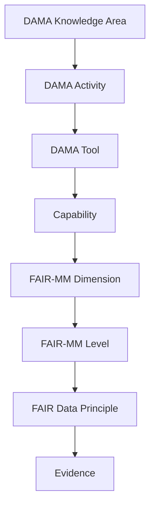

# DAMA–FAIR Tools & Infrastructure Mapping

**Version:** 1.1.0  
**Status:** Proposed semantic alignment

## 1. Purpose and semantic scope

This document aligns the DAMA tool catalogue with the 15 numbered FAIR Data Principles and the FAIR Maturity Matrix (FAIR-MM) dimension D7, FAIR Tools and Infrastructures.

| Ontology | Semantic responsibility |
|---|---|
| DAMA | Data management knowledge areas, activities and supporting tools |
| FAIR | Canonical FAIR Data Principles |
| FAIR-MM | Organisational maturity dimensions and levels |

Direct support means a tool provides a mechanism capable of implementing a principle. Indirect support means it facilitates, governs, validates, monitors or sustains implementation. Neither establishes resource-level FAIR conformance without evidence.

The DAMA tool names derive from the v1.18.0 catalogue. The retrieved DAMA ontology v1.1.0 did not explicitly enumerate the tools as entities. The mappings below are proposed assertions, not existing OWL entailments. The maturity ranges are indicative contribution ranges, not intrinsic tool ratings or normative thresholds. Upper bounds do not preclude use at higher levels. General-purpose tools contribute only where a demonstrable FAIR-related function exists. An asterisk indicates conditional support; all direct support ultimately depends on implementation.

## 2. FAIR-MM maturity levels

| Level | Name | D7 capability progression |
|---|---|---|
| L0 | Life is unFAIR | Ad hoc tooling, fragmented infrastructure and unstructured capture |
| L1 | Started the FAIR journey | Tool inventory, initial metadata centralisation, planned proofs of concept |
| L2 | Getting FAIR | Working proofs of concept, metadata publication, persistent identifiers and controlled vocabularies |
| L3 | Pretty FAIR | Established tooling, prospective FAIRification, reference models and rollout |
| L4 | Really FAIR | Enterprise-wide implementation, semantic models, APIs and automated exploration |
| L5 | FAIRest of them all | Automated FAIRification, lifecycle validation, machine-actionability, federation and community leadership |

## 3. DAMA tools: FAIR principles and maturity levels

### 3.1 Findability and metadata management

| DAMA Tool | Direct FAIR Principles | Indirect FAIR Principles | FAIR-MM Level |
|---|---|---|---|
| Metadata Repositories | F2, F3, F4, R1 | F1, A1, A2, I1, I2, I3, R1.2, R1.3 | L1–L5 |
| Metadata Repository Management Tools | F2, F3, F4, R1 | F1, A1, A2, I1, I2, I3, R1.2, R1.3 | L2–L5 |
| Metadata Repositories in other Tools | F2, F3, R1 | F4, I1, I2, I3, R1.2 | L1–L5 |
| Business Glossary Tools | I2* | F2, F4, I1, I3, R1, R1.3 | L1–L5 |
| Asset Management Software | F4* | F1, F2, F3, A1, R1 | L1–L4 |
| Knowledge Management and Metadata Repositories | F2, F4 | F3, A1, I2, R1, R1.3 | L1–L5 |
| Metadata Tracking | R1.2* | F2, F3, A2, R1 | L3–L5 |
| Data Enrichment | F2, R1 | F3, I2, I3, R1.2, R1.3 | L2–L5 |

### 3.2 Accessibility and security

| DAMA Tool | Direct FAIR Principles | Indirect FAIR Principles | FAIR-MM Level |
|---|---|---|---|
| Identity Management Technology | A1.2 | A1 | L2–L5 |
| Webpage Security | A1.2* | A1 | L2–L5 |
| Anti-virus and Security Software | — | A1 | L1–L5 |
| Intrusion Detection and Prevention Software | — | A1, A1.2 | L2–L5 |
| Firewalls | — | A1, A1.2 | L1–L5 |
| Data Masking / Encryption | — | A1.2 | L2–L5 |
| Database Management Tools | A1* | F1, F4, A1.1, A1.2, A2 | L1–L5 |
| Database Monitoring Tools | — | A1, A2 | L2–L5 |
| Operational Data Stores | A1* | F1, F3, F4, A2 | L2–L5 |
| Distributed File-based Databases | A1* | F1, F4, A2 | L2–L5 |
| Big Data Cloud Solutions | A1* | F4, A1.1, A1.2, A2 | L2–L5 |
| Data Sharing Hubs | F4, A1* | F1, F2, A1.1, A1.2, I1, R1.1 | L3–L5 |
| Websites | A1, A1.1* | F4, F2, A2, R1.1 | L1–L5 |

### 3.3 Semantic interoperability and modelling

| DAMA Tool | Direct FAIR Principles | Indirect FAIR Principles | FAIR-MM Level |
|---|---|---|---|
| Data Modelling Tools | I1* | F2, F3, I2, I3, R1, R1.3 | L2–L5 |
| Data and Process Modelling Tools | I1* | F2, I2, I3, R1.2, R1.3 | L2–L5 |
| Controlled Vocabulary / Metadata Tool | I2* | F2, F4, I1, I3, R1, R1.3 | L1–L5 |
| Data Model Patterns | — | I1, I3, R1.3 | L3–L5 |
| Industry Data Models | R1.3* | I1, I2, I3 | L2–L5 |
| Data Transformation Engine | I1* | F2, I2, I3, R1.2, R1.3 | L2–L5 |
| Data Transformation and Standardisation | I1, R1.3* | F2, I2, I3, R1.2 | L2–L5 |
| Data Parsing and Formatting | I1* | I2, R1.3 | L2–L5 |
| Data Integration Tools | I1, I3* | F3, A1, I2, R1.2, R1.3 | L2–L5 |
| Integration Tools | I1, I3* | F3, A1, I2, R1.2 | L2–L5 |
| Data Virtualisation Server | A1* | F4, A1.1, A1.2, I1, I3 | L3–L5 |
| Enterprise Service Bus | A1* | A1.1, A1.2, I1, I3 | L3–L5 |
| MDM Application Platforms | F1, I3* | F2, F3, F4, I2, R1.2, R1.3 | L1–L5 |

### 3.4 Reusability, provenance and content management

| DAMA Tool | Direct FAIR Principles | Indirect FAIR Principles | FAIR-MM Level |
|---|---|---|---|
| Lineage Tools | R1.2* | F3, I3, R1 | L3–L5 |
| Document Management Tools | F2, F4* | F1, F3, A1, A2, R1.1, R1.2 | L1–L5 |
| Enterprise Content Management System | F2, F4, A1* | F1, F3, A2, R1.1, R1.2 | L1–L5 |
| Knowledge Management Wiki | F2, A1* | F4, I2, I3, R1 | L1–L4 |
| Wikis, Knowledge Bases, Intranet Sites | F2, A1* | F4, I2, I3, R1 | L1–L4 |
| E-discovery Technology | F4* | F2, F3, A1, R1.2 | L2–L5 |
| Data Remediation Tools | — | F2, I1, I2, R1, R1.3 | L2–L5 |

### 3.5 Validation, governance and assessment

| DAMA Tool | Direct FAIR Principles | Indirect FAIR Principles | FAIR-MM Level |
|---|---|---|---|
| Data Profiling Tools | — | F2, R1, R1.3 | L1–L5 |
| Business Rules Engine | — | F2, F3, I1, I2, I3, R1, R1.3 | L2–L5 |
| Workflow Tools | R1.2* | F2, F3, I3, R1.1, R1.3 | L2–L5 |
| Data Governance Scorecards | — | All 15 principles, where measured | L2–L5 |
| Data Management Maturity Frameworks | — | All 15 principles, where assessed | L1–L5 |
| Incident Management | — | A1, A2, R1.2 | L2–L5 |
| Collaboration Tools | — | F2, I2, R1.3 | L1–L5 |
| Developer Support Tools | — | A1, I1, R1.2, R1.3 | L2–L5 |
| Communications Plan | — | R1.3* | L1–L4 |

### 3.6 Analytical and supporting infrastructure

| DAMA Tool | Direct FAIR Principles | Indirect FAIR Principles | FAIR-MM Level |
|---|---|---|---|
| Business Intelligence Tools | — | F2, A1, R1 | L2–L5 |
| MPP Shared-Nothing Technologies | — | A1 | L3–L5 |
| In-memory Computing and Databases | A1* | F4 | L2–L5 |
| In-database Algorithms | — | R1.2 | L3–L5 |
| Statistical Computing and Graphical Languages | — | R1.2, R1.3 | L2–L5 |
| Data Visualisation Tools | — | F2, R1 | L2–L5 |
| Graphical Design Applications | — | F2, R1 | L1–L3 |
| Office Productivity Software | — | F2, R1 | L0–L3 |
| Visual Media Tool | — | F2, R1 | L1–L3 |
| Social Media | — | F4 | L1–L3 |
| Microblogs and Internal Communication Tools | — | F4, R1 | L1–L3 |

L0 denotes an ad hoc baseline, not evidence of FAIR capability. Data model patterns, industry models and communications plans are supporting artefacts rather than software tools in the strict sense; their catalogue classification is retained for continuity.

## 4. FAIR-specific tooling extensions

| Proposed FAIR Tool | Direct FAIR Principles | Indirect FAIR Principles | FAIR-MM Level |
|---|---|---|---|
| Persistent Identifier Service | F1 | F3, F4, A1 | L1–L5 |
| Identifier Resolution Service | A1, A1.1 | F1, F3 | L2–L5 |
| Metadata Catalogue and Registry | F4 | F1, F2, F3, R1 | L1–L5 |
| FAIR Data Point | F2, F3, F4, A1* | A2, I1, I2, I3, R1 | L2–L5 |
| FAIR Data Service | A1, A1.1, A1.2* | F1, I1, I3, R1 | L3–L5 |
| Metadata Preservation Service | A2 | F1, F3, A1 | L3–L5 |
| Ontology Engineering Tool | I1* | I2, I3, R1.3 | L2–L5 |
| FAIR Vocabulary Registry | I2, F4* | F1, F2, I1, R1.3 | L2–L5 |
| Semantic Mapping Tool | I1, I3* | I2, R1.3 | L3–L5 |
| Data Licensing Service | R1.1 | A1.2, R1 | L3–L5 |
| Provenance Management Service | R1.2 | F2, I3, R1 | L3–L5 |
| Community Standards Registry | F4 | I1, I2, R1.3 | L3–L5 |
| FAIR Implementation Profile Registry | F4 | All 15 principles | L4–L5 |
| SHACL Validation Tool | — | All applicable, testable principles | L3–L5 |
| FAIR Assessment Tool | — | All 15 principles | L2–L5 |
| Automated FAIRification Platform | All implemented principles* | All assessed or enabled principles | L4–L5 |
| FAIR Federation Infrastructure | F4, A1, A1.1* | F1, A1.2, I1, I2, I3, R1.3 | L5 |

## 5. FAIR-MM capability evolution

Legend: — not in focus; P planned or partial; E established or emerging; M mature or scaled. This is a proposed capability progression, not a normative maturity scoring algorithm.

| Capability | L0 | L1 | L2 | L3 | L4 | L5 |
|---|---|---|---|---|---|---|
| Office productivity | P | E | E | P | P | P |
| Metadata management | — | P | E | E | M | M |
| Persistent identifiers | — | P | E | E | M | M |
| Controlled vocabularies | — | P | E | E | M | M |
| Authentication & authorisation | — | — | P | E | M | M |
| FAIR Data Points | — | — | P | E | M | M |
| Semantic modelling | — | — | P | E | M | M |
| Metadata preservation | — | — | — | E | M | M |
| Licensing | — | — | — | E | M | M |
| Provenance management | — | — | — | E | M | M |
| FAIR assessment | — | — | E | E | M | M |
| FAIR Implementation Profiles | — | — | — | — | E | M |
| Automated FAIRification | — | — | — | P | E | M |
| Lifecycle FAIR validation | — | — | — | P | E | M |
| FAIR federation | — | — | — | — | P | M |

## 6. Example: Metadata Repository maturity progression

| FAIR-MM Level | Metadata Repository capability | FAIR Principles supported |
|---|---|---|
| L0 | Fragmented, unstructured metadata | None assured |
| L1 | Centralised metadata collection | F2 |
| L2 | Structured metadata, identifier association and searchable catalogues | F1, F2, F3, F4 |
| L3 | Governed templates, prospective metadata capture and provenance | F1–F4, I2, R1, R1.2 |
| L4 | Semantic metadata, standardised APIs and enterprise-wide publication | F1–F4, A1, A1.1, I1–I3, R1–R1.3 |
| L5 | Automated, federated, validated and persistently accessible metadata | Potentially all 15 principles |

The tool remains the same conceptual entity, but implemented capabilities and associated FAIR contributions evolve. This progression is illustrative, not a prescribed conformance threshold.

## 7. Extended ontology relationship model

Introduce a reified `ToolMaturityContribution` entity rather than assigning intrinsic maturity to a tool. Each assertion can carry provenance, implementation conditions and evidence requirements.



### 7.1 Proposed ontology properties

| Property | Domain | Range |
|---|---|---|
| `hasMaturityContribution` | DAMA Tool | Tool Maturity Contribution |
| `forTool` | Tool Maturity Contribution | DAMA Tool |
| `forDimension` | Tool Maturity Contribution | FAIR-MM Dimension |
| `supportsMaturityLevel` | Tool Maturity Contribution | FAIR-MM Level |
| `directlySupportsFAIRPrinciple` | Tool Maturity Contribution | FAIR Data Principle |
| `indirectlySupportsFAIRPrinciple` | Tool Maturity Contribution | FAIR Data Principle |
| `requiresCapability` | Tool Maturity Contribution | Capability |
| `hasSupportingEvidence` | Tool Maturity Contribution | Evidence |
| `hasImplementationCondition` | Tool Maturity Contribution | Implementation Condition |

### 7.2 Example RDF/Turtle

The `map:`, `fairmm:`, and `cap:` namespaces and tool identifiers below are illustrative proposals, not registered canonical IRIs.

```turtle
@prefix dama: <https://github.com/chris-day/FAIR-DAMA/blob/main/artefacts/dama-ontology.ttl#> .
@prefix fair: <https://w3id.org/fair/principles/terms/> .
@prefix map: <https://example.org/dama-fair/mapping#> .
@prefix fairmm: <https://example.org/fair-mm#> .
@prefix cap: <https://example.org/fair-capability#> .

map:MetadataRepository-L2
    a map:ToolMaturityContribution ;
    map:forTool dama:MetadataRepository ;
    map:forDimension fairmm:ToolsAndInfrastructure ;
    map:supportsMaturityLevel fairmm:Level2 ;
    map:directlySupportsFAIRPrinciple fair:F2, fair:F3, fair:F4 ;
    map:indirectlySupportsFAIRPrinciple fair:F1, fair:R1 ;
    map:requiresCapability cap:StructuredMetadataCapture,
        cap:ResourceIdentifierAssociation,
        cap:SearchableMetadataRegistration .

map:MetadataRepository-L5
    a map:ToolMaturityContribution ;
    map:forTool dama:MetadataRepository ;
    map:forDimension fairmm:ToolsAndInfrastructure ;
    map:supportsMaturityLevel fairmm:Level5 ;
    map:directlySupportsFAIRPrinciple fair:F2, fair:F3, fair:F4,
        fair:A1, fair:A2, fair:I1, fair:I3, fair:R1, fair:R1.2 ;
    map:indirectlySupportsFAIRPrinciple fair:F1, fair:A1.1, fair:A1.2,
        fair:I2, fair:R1.1, fair:R1.3 ;
    map:requiresCapability cap:AutomatedMetadataPublication,
        cap:SemanticMetadataManagement,
        cap:FederatedMetadataDiscovery,
        cap:MetadataPreservation,
        cap:ProvenanceCapture .
```

This permits direct and indirect FAIR support to vary by maturity level without contradictory assertions about the DAMA Tool itself.

## 8. Authoritative source alignment

| Source | Purpose |
|---|---|
| [DAMA Segments v1.18.0](https://github.com/chris-day/FAIR-DAMA/blob/main/artefacts/DAMA_Segments_High_Level_v1.18.0.md) | DAMA Tool catalogue |
| [DAMA Ontology](https://github.com/chris-day/FAIR-DAMA/blob/main/artefacts/dama-ontology.ttl) | DAMA conceptual model |
| [DAMA–FAIR Mapping Ontology](https://github.com/chris-day/FAIR-DAMA/blob/main/artefacts/dama-fair-mapping.ttl) | Existing mapping layer |
| [FAIR Ontology](https://peta-pico.github.io/FAIR-nanopubs/principles/ontology.ttl) | Canonical FAIR principles |
| [FAIR-MM Dimension D7](https://github.com/chris-day/FAIR-Maturity-Matrix/blob/main/docs/fmm-d7.md) | Tools & Infrastructure dimension |
| [FAIR-MM Level 0](https://github.com/chris-day/FAIR-Maturity-Matrix/blob/main/docs/level0.md#level-0-fair-tools-and-infrastructures) | Ad hoc tooling |
| [FAIR-MM Level 1](https://github.com/chris-day/FAIR-Maturity-Matrix/blob/main/docs/level1.md#level-1-fair-tools-and-infrastructures) | Initial tooling |
| [FAIR-MM Level 2](https://github.com/chris-day/FAIR-Maturity-Matrix/blob/main/docs/level2.md#level-2-fair-tools-and-infrastructures) | Working implementations |
| [FAIR-MM Level 3](https://github.com/chris-day/FAIR-Maturity-Matrix/blob/main/docs/level3.md#level-3-fair-tools-and-infrastructures) | Established tooling |
| [FAIR-MM Level 4](https://github.com/chris-day/FAIR-Maturity-Matrix/blob/main/docs/level4.md#level-4-fair-tools-and-infrastructures) | Enterprise integration |
| [FAIR-MM Level 5](https://github.com/chris-day/FAIR-Maturity-Matrix/blob/main/docs/level5.md#level-5-fair-tools-and-infrastructures) | Automation and federation |
| [Wilkinson et al., 2016](https://doi.org/10.1038/sdata.2016.18) | Original FAIR guiding principles |

## 9. Recommended architectural direction



The traceability chain is a conceptual navigation path, not an OWL property chain or an entailment rule. It provides a basis for machine-actionable organisational FAIR maturity assessment grounded in DAMA practices, whilst keeping organisational maturity distinct from resource-level FAIR conformance.

### 9.1 Further work

1. Extend the mapping across all seven FAIR-MM dimensions.
2. Replace indicative maturity ranges with explicit, evidence-based capability requirements for each tool and level.
3. Formalise the mappings in a dedicated DAMA Tool Ontology, FAIR-MM alignment ontology and SHACL validation suite.

## 10. Version history

| Version | Change |
|---|---|
| 1.0.0 | Initial DAMA tool mapping to direct and indirect FAIR principles |
| 1.1.0 | Added FAIR-MM D7 level associations, capability progression, maturity-specific contribution model and examples |
