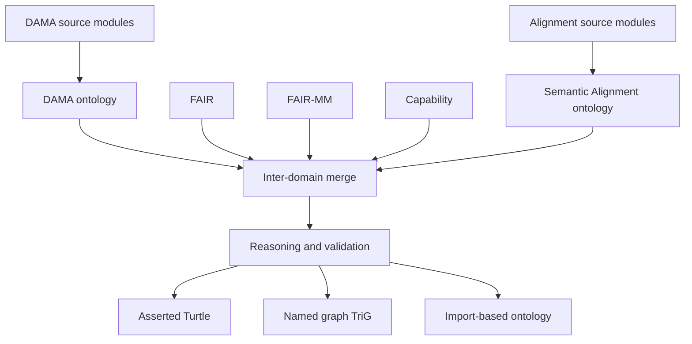
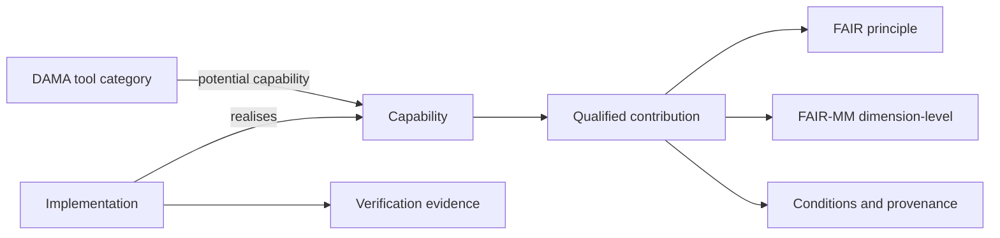

# Approved Ontology Architecture

## Semantic authority
| Artefact | Authority | Release model |
|---|---|---|
| DAMA | Knowledge areas, topics, activities, inputs, outputs, personas, roles, tools, techniques, metrics | One ontology assembled from source modules |
| FAIR | Canonical 15 principles | External authoritative source, pinned |
| FAIR-MM | Dimensions, levels, indicators | Independent authoritative source, pinned |
| Capability | Domain-neutral capabilities, requirements, realisations, profiles | Independent release |
| Semantic Alignment | Project-governed cross-domain mappings | Shared DAMA/FAIR maintenance; one release from internal modules |
| Integrated | Derived consumption model | Generated and independently versioned |

## Semantic model
DAMA tool categories are not deployments. Model contextual roles rather than exclusive supplier/participant/consumer persona subclasses. Use a reusable capability vocabulary and distinguish potential capability from realisation. Qualified contribution assertions identify tool or capability, principle, direct/indirect type, dimension-level context, implementation conditions, source, rationale and review status. Separate mapping approval from deployment verification. Do not assume that tools fulfil a principle or achieve an organisational maturity level. D7 mappings are proposed starting hypotheses. FAIR-MM level ranges are summaries, not normative constraints; do not expand a range into unqualified facts.

The cross-domain edges above belong to the alignment layer. Separate principle and maturity assertions may be joined only when their contexts and conditions are compatible. No unconditional property chain should infer verified conformance from a category-level mapping.

## Repository layout (proposed)
Existing DAMA and FAIR-MM repositories remain in place. Proposed new repositories: Capability-Ontology, Semantic-Alignment-Ontology and FAIR-DAMA-Integrated. Discover actual workspace layout first. Keep authored and generated files separate; preserve established paths where required by consumers. No repository creation or access changes without approval.

## Publication
Three consolidation operations: DAMA modules, alignment modules, then inter-domain integration. Publish standalone asserted graph, source-separated dataset and logical import entrypoint. Optional inference output is separate. See merge and test specifications. All 13 ADRs resolved; unresolved implementation choices are not licence to redesign the architecture.
