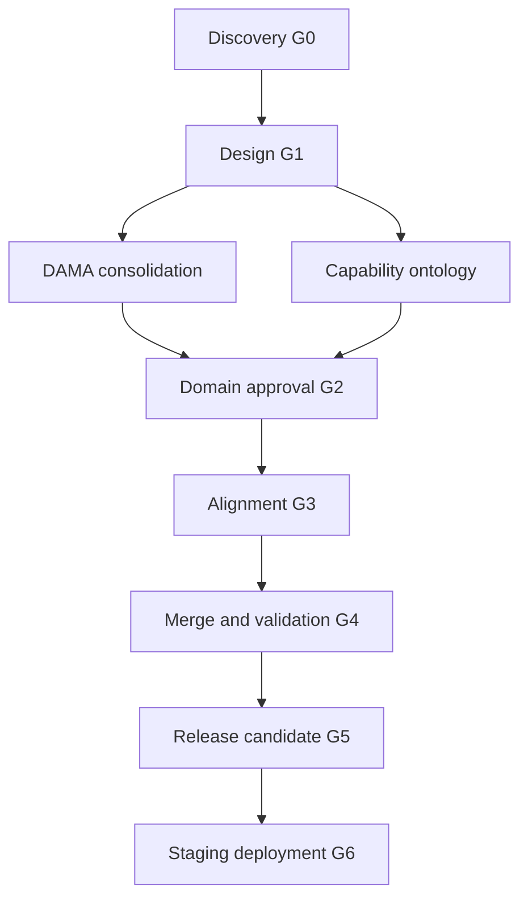

# Execution Plan

## Work packages and gates
Indicative effort is a planning assumption, not a commitment; re-estimate after discovery. DAMA and Capability development can run in parallel after G1.

| Phase | Work package | Dependency | Outputs | Gate |
|---|---|---|---|---|
| 0 | Read-only repository discovery; capture commits, entity counts, source coverage, imports, mappings, tests, consumers, dirty status | None | D02 source reconciliation report; risks and impact | G0 source approval |
| 1 | Reconcile architecture with source; define exact namespaces, semantic modelling profile, migration plan, test fixtures and governance | G0 | D01 verified architecture; implementation decisions | G1 design approval |
| 2 | Consolidate DAMA modules, preserve personas and tools, contextual roles and legacy IRIs; reconcile misplaced mappings | G1 | D03 consolidated DAMA; D10 build | G2 domain approval |
| 3 | Define independent capabilities, requirements, profiles, realisations, conditions and evidence | G1 | D04 capability ontology | G2 domain approval |
| 4 | Create shared alignment ontology; migrate existing assertions losslessly; qualify D7 mapping hypotheses; review cross-domain claims | G2 | D05–D09 alignment modules and single release | G3 alignment approval |
| 5 | Resolve pinned closure, build import entrypoint, flat graph and named graph dataset | G3 | D11–D12 merge and integrated output | G4 integration approval |
| 6 | Validate source and integrated graphs, run reasoner, SHACL fixtures and competency queries; remediate regressions | Phase 5 (tests designed earlier) | D13–D15 test reports | G4 integration approval |
| 7 | Automate build/release, lockfiles, source provenance, documentation generation | G4 | D16 generated mapping docs and release candidate | G5 release approval |
| 8 | Stage GraphDB deployment, validate queries and rollback; publish only if authorised | G5 | D17 deployment profile and evidence | G6 operational acceptance |

## Deliverable register
| ID | Deliverable | Target version |
|---|---|---|
| D01 | Architecture and design | 1.4.0 baseline; revise only by approval |
| D02 | Source and namespace inventory | 1.0.0 |
| D03 | Consolidated DAMA | Determine compatibility after discovery |
| D04 | Capability ontology | 1.0.0 |
| D05 | DAMA–Capability alignment module | Alignment release 1.0.0 |
| D06 | Capability–FAIR module | Alignment release 1.0.0 |
| D07 | Capability–FAIR-MM module | Alignment release 1.0.0 |
| D08 | DAMA–FAIR module | Preserve legacy version history |
| D09 | DAMA–FAIR-MM module; assess FAIR-MM–FAIR module | Alignment release 1.0.0 |
| D10 | DAMA consolidation pipeline | 1.0.0 |
| D11 | Alignment consolidation and inter-domain merge pipeline | 1.0.0 |
| D12 | Integrated ontology release | 1.0.0 |
| D13 | SHACL validation suite | 1.0.0 |
| D14 | SPARQL competency query suite | 1.0.0 |
| D15 | Regression suite | 1.0.0 |
| D16 | Generated semantic mapping documentation | 1.2.0 proposed |
| D17 | GraphDB deployment profile | 1.0.0 |

## Indicative sequence
Iteration 1: discovery and design. Iteration 2: DAMA and capability domain models. Iteration 3: alignment. Iteration 4: integration and regression. Iteration 5: release and staging. Allocate effort only after inventory and mapping review; the critical path is G0 → G1 → G2 → G3 → G4 → G5 → G6.

## Risk register
| Risk | Mitigation | Owner role |
|---|---|---|
| Missing FAIR-MM RDF source | Verify canonical authority; obtain approval for any new representation | FAIR-MM maintainer |
| Legacy IRI breakage | Inventory and graph regression; compatibility strategy | DAMA maintainer |
| Conditional mapping inflated into conformance | Qualified assertions and negative tests | Alignment reviewers |
| Conflicting alignment semantics | Shared review and reasoner | Alignment maintainers |
| External dependency drift | Immutable revisions and hashes | Build maintainer |
| Data loss during migration | Triple-level reconciliation and rollback | DAMA maintainer |
| Named graph query differences | Explicit dataset/union policy and tests | Deployment maintainer |
| Unknown permissions or repository layout | Discover; request approval for provisioning | Project owner |

## Gate protocol
For every gate deliver artefacts, source revision references, test results, semantic diffs, open risks, and explicit approval request. No bypass for semantic regressions. Record approvals in versioned decision log. Do not publish or deploy on the basis of this plan alone.
