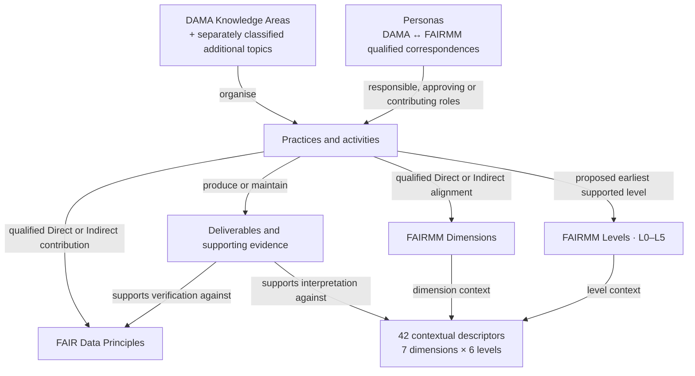

# FAIR–DAMA–FAIRMM High-Level Connections

This document proposes five connected views of FAIR delivery: FAIR Data Principles, Personas, FAIRMM Dimensions, FAIRMM Levels and DAMA Knowledge Areas. These are called **alignment perspectives** to distinguish them from the seven specific FAIRMM Dimensions.

Practices, activities, deliverables and supporting evidence form the connecting layer. They give each proposed relationship an explicit basis and preserve the distinction between a management capability, a person's participation and a demonstrated property of a data resource.

| Alignment perspective | What it describes | Principal connection |
|---|---|---|
| FAIR Data Principles | Properties required of data and metadata | DAMA practices contribute Directly or Indirectly to specific principles; those practices can also support FAIRMM capabilities. |
| Personas | People and roles involved in delivery | DAMA personas participate in activities; qualified proposed correspondences connect them to FAIRMM personas and contextual Producer, Consumer or Enabler roles. |
| FAIRMM Dimensions | Seven capability areas: FAIR Data, Leadership, Strategy, Personas, Processes, Knowledge, Tools and Infrastructure | DAMA practices support individual dimensions; each dimension has a contextual description at every maturity level. |
| FAIRMM Levels | Development of capability from L0 to L5 | Levels contextualise each dimension; proposed DAMA associations begin at an earliest supported level and carry forward. |
| DAMA Knowledge Areas | Management disciplines that organise delivery | Knowledge areas organise practices and activities, connecting deliverables, persona responsibilities and FAIR contributions. Additional topics remain separately classified. |

The diagram summarises relationship types. It does not imply that every practice connects to every perspective or that a proposed relationship establishes implementation.

## DAMA → FAIR Principles

This connection explains how management practices support resource-level FAIR requirements. Knowledge-area membership supplies the management context; the activity, its deliverable and its applicability conditions supply the basis for a qualified contribution assertion.

Direct contributions produce or verify evidence relevant to a particular principle. Indirect contributions identify an intermediate practice through which that evidence would be produced or verified. Source classifications from summaries, activity tables, ontology examples and area-level proposals remain distinct.

Further elaboration will describe the practice-to-principle pathways, required deliverables, intermediate practices, evidence requirements and source-layer differences.

## DAMA → FAIRMM Dimensions

This connection explains which organisational capabilities DAMA practices support. The seven FAIRMM Dimensions provide complementary capability perspectives rather than subdivisions of the FAIR Data Principles.

Each proposed alignment retains its originating practice and knowledge-area or additional-topic context, one dimension target, a Direct or Indirect contribution type, rationale, conditions and supporting descriptor references. The FAIRMM contribution type remains separate from the source FAIR-principle classification.

Further elaboration will examine each dimension, its supporting DAMA practices and deliverables, conditional support, uncovered capabilities and relevant personas. The focused Tools and Infrastructure/persona Sankey provides an initial example of this traversal.

## Dimensions × Levels

This connection supplies the 42 contextual descriptions against which proposed capability alignments are interpreted: seven dimensions across six maturity levels.

Dimensions and levels are flat vocabularies of named individuals. Their contextual Descriptor individuals each reference exactly one dimension and one level. Descriptors are contextual descriptions, not subprinciples. Level ordering is explicit; neither dimensions nor levels are subclasses of one another.

Further elaboration will preserve exact descriptor wording separately from interpreted capabilities and examine how scope, integration, governance and operational expectations develop across L0–L5.

## Personas → Activities → Outcomes

This connection explains who participates, through which source responsibilities, and with which intended outputs. Responsible, Approving and Contributing activity-role occurrences remain separate from area-level Supplier, Participant and Consumer occurrences.

Qualified Close, Partial or Gap correspondences connect DAMA and FAIRMM persona catalogues. A Gap identifies a missing or insufficient correspondence; it does not assert equivalence. Producer, Consumer and Enabler assignments remain contextual to an activity or practice. FAIRMM Personas is both a capability dimension and a separate catalogue of actor archetypes; these resources have different meanings.

Persona participation does not automatically inherit a practice's Direct or Indirect classification, appoint an individual or establish personal accountability. Deliverables are intended outputs; demonstrated FAIR outcomes require supporting evidence.

Further elaboration will describe role occurrences, persona correspondences, activity handoffs, decision rights, deliverables, evidence and unresolved source labels. The existing persona Sankey traces participation through activities rather than inferring responsibility from area membership.

## DAMA → Levels

This connection provides the cumulative association view. An earliest-supported-level judgement identifies the first level at which a particular practice contribution is supported by a descriptor and the documentary source.

For an onset at level k, associations carry forward through L5 while retaining the originating area or topic, practice, first-supported level and contribution type. Introduced and inherited associations remain distinguishable, with explicit onset and derivation references. Indirect support is never promoted to Direct through inheritance.

L0 remains diagnostic, without positive alignment assertions. Cumulative area association does not establish that an organisation has attained a maturity level or require every earlier process to remain unchanged. The 11 core knowledge areas remain distinct from additional supporting topics, and inclusion in a diagram does not change that classification.

Further elaboration will examine onset rationales, progression context, cumulative derivation rules, scope exceptions and the evidence that would be needed for a separate maturity assessment.

---

**Proposed presentation:** arrange the five alignment perspectives around a central **Practices and Evidence** hub. Selectable relationships could open the relevant detailed Sankeys and qualified ontology assertions. This is a conceptual presentation proposal, not an implemented interface.

**Local documentary basis:** the supplied DAMA ontology v1.1.0, DAMA Segments document v1.18.0 and V3 workbook release of 16 November 2026; FAIRMM branch `FAIR-MM-V1.2.5`, revision `8ff4676eb340b0da5034ffb3d0e901c594c3cfc4`. See the [source refresh](../docs/source-refresh.md), [ontology documentation](../docs/ontology.md) and [Tools and Infrastructure persona analysis](../docs/tools-personas/index.md). Existing component attribution and licensing notices remain applicable.

**Versioning:** use semantic versions. Major versions change the conceptual structure or relationship meanings; minor versions add substantive elaboration or new connections; patch versions correct wording, references or presentation without changing meaning. Preserve this initial version as the starting point for subsequent elaboration.

**Change history:** v1.0.0 — 19 November 2026: initial five-perspective structure, connection diagram and five connection sections captured from the agreed discussion for further elaboration.
